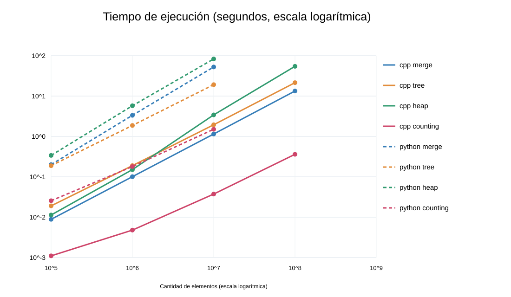
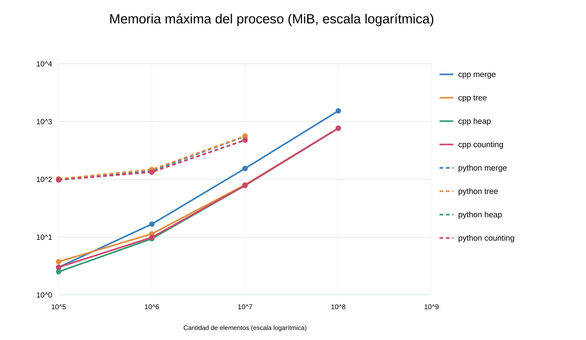

# Práctica 2. Comparación de algoritmos de ordenamiento

**Materia:** Análisis y Diseño de Algoritmos
**Fecha:** 30 de octubre de 2026
**Integrantes:** Rosas Ríos Luis Gabriel, García Mata Leonardo y Cruz Rodríguez Aldo Giovanni Baruch.

## Objetivo

Implementar y comparar cinco algoritmos de ordenamiento en C++ y Python mediante el tiempo de ejecución y la memoria residente del proceso.

## Metodología

Se generaron arreglos reproducibles de números reales de dos decimales, entre -500.00 y 500.00, con semilla 42. Counting Sort convierte cada centésimo a una clave entera; por ello sus resultados aplican a valores acotados con esa precisión. Los tiempos consideran solo el ordenamiento y la memoria es el máximo del proceso completo, no exclusivamente la memoria auxiliar. Ambiente de pruebas: Linux, AMD EPYC 9V74, Python 3.13, g++ 14.2 con optimización -O2, límite de 4 GiB de RAM.

## Complejidades

| Método | Tiempo habitual | Memoria auxiliar |
|---|---|---|
| Bubble Sort | O(n²) | O(1) |
| Merge Sort | O(n log n) | O(n) |
| Tree Sort | O(n log n) promedio, O(n²) peor | O(u), nodos diferentes |
| Heap Sort | O(n log n) | O(1) |
| Counting Sort | O(n+k) | O(k) |

## Resultados

El guion significa que el experimento no fue ejecutado. Nunca significa tiempo cero.

### CPP

| Algoritmo | Elementos | Tiempo (s) | Memoria (MiB) | Estado |
|---|---:|---:|---:|---|
| bubble | 100,000 | — | — | omitido |
| merge | 100,000 | 0.008853 | 3.000 | medido |
| tree | 100,000 | 0.019072 | 3.750 | medido |
| heap | 100,000 | 0.011332 | 2.512 | medido |
| counting | 100,000 | 0.001102 | 3.000 | medido |
| bubble | 1,000,000 | — | — | omitido |
| merge | 1,000,000 | 0.100781 | 16.750 | medido |
| tree | 1,000,000 | 0.189202 | 11.375 | medido |
| heap | 1,000,000 | 0.150751 | 9.379 | medido |
| counting | 1,000,000 | 0.004787 | 9.875 | medido |
| bubble | 10,000,000 | — | — | omitido |
| merge | 10,000,000 | 1.148765 | 154.125 | medido |
| tree | 10,000,000 | 1.946007 | 80.125 | medido |
| heap | 10,000,000 | 3.418573 | 78.039 | medido |
| counting | 10,000,000 | 0.037397 | 78.625 | medido |
| bubble | 100,000,000 | — | — | omitido |
| merge | 100,000,000 | 13.342884 | 1527.375 | medido |
| tree | 100,000,000 | 21.478708 | 766.625 | medido |
| heap | 100,000,000 | 54.553883 | 764.691 | medido |
| counting | 100,000,000 | 0.361014 | 765.250 | medido |
| bubble | 1,000,000,000 | — | — | omitido |
| merge | 1,000,000,000 | — | — | omitido |
| tree | 1,000,000,000 | — | — | omitido |
| heap | 1,000,000,000 | — | — | omitido |
| counting | 1,000,000,000 | — | — | omitido |

### PYTHON

| Algoritmo | Elementos | Tiempo (s) | Memoria (MiB) | Estado |
|---|---:|---:|---:|---|
| bubble | 100,000 | — | — | omitido |
| merge | 100,000 | 0.200677 | 98.129 | medido |
| tree | 100,000 | 0.188478 | 101.809 | medido |
| heap | 100,000 | 0.338954 | 97.383 | medido |
| counting | 100,000 | 0.025561 | 98.008 | medido |
| bubble | 1,000,000 | — | — | omitido |
| merge | 1,000,000 | 3.333540 | 140.879 | medido |
| tree | 1,000,000 | 1.870800 | 147.637 | medido |
| heap | 1,000,000 | 5.756147 | 134.008 | medido |
| counting | 1,000,000 | 0.179494 | 133.258 | medido |
| bubble | 10,000,000 | — | — | omitido |
| merge | 10,000,000 | 52.517120 | 554.012 | medido |
| tree | 10,000,000 | 19.164496 | 560.762 | medido |
| heap | 10,000,000 | 83.090487 | 478.387 | medido |
| counting | 10,000,000 | 1.503646 | 477.633 | medido |
| bubble | 100,000,000 | — | — | omitido |
| merge | 100,000,000 | — | — | omitido |
| tree | 100,000,000 | — | — | omitido |
| heap | 100,000,000 | — | — | omitido |
| counting | 100,000,000 | — | — | omitido |
| bubble | 1,000,000,000 | — | — | omitido |
| merge | 1,000,000,000 | — | — | omitido |
| tree | 1,000,000,000 | — | — | omitido |
| heap | 1,000,000,000 | — | — | omitido |
| counting | 1,000,000,000 | — | — | omitido |

## Gráficas

## Análisis

Counting Sort obtuvo los mejores tiempos en los valores con precisión fija, pero su eficacia depende del rango de las claves. Heap Sort evita el arreglo auxiliar de Merge Sort y Tree Sort necesita nodos adicionales. Los resultados de C++ y Python no son equivalentes en términos de sobrecarga del intérprete; se comparan procesos completos. Bubble Sort fue verificado con datos pequeños, pero no se ejecutó en los tamaños principales por su complejidad cuadrática. Mil millones de valores de 64 bits requieren unos 7.45 GiB solo para el arreglo, superando el límite de 4 GiB.

## División de actividades

| Integrante | Tarea asignada |
|---|---|
| Rosas Ríos Luis Gabriel | Bubble Sort, Merge Sort y documentación. |
| García Mata Leonardo | Tree Sort, Heap Sort y pruebas de corrección. |
| Cruz Rodríguez Aldo Giovanni Baruch | Counting Sort, mediciones y gráficas. |

La asignación anterior es una propuesta organizativa del equipo; la participación efectiva de cada integrante deberá ser confirmada por ellos.

## Conclusión

En esta práctica se observaron diferencias importantes tanto entre métodos como entre lenguajes. Counting Sort fue el más rápido en este conjunto particular de números reales discretizados. Para datos generales, Merge Sort y Heap Sort mantienen una complejidad O(n log n) garantizada, mientras que Tree Sort depende de la forma del árbol. El consumo de memoria también debe considerarse al escoger un método. Las pruebas no ejecutadas se identificaron expresamente y pueden repetirse con hardware de mayor capacidad.
